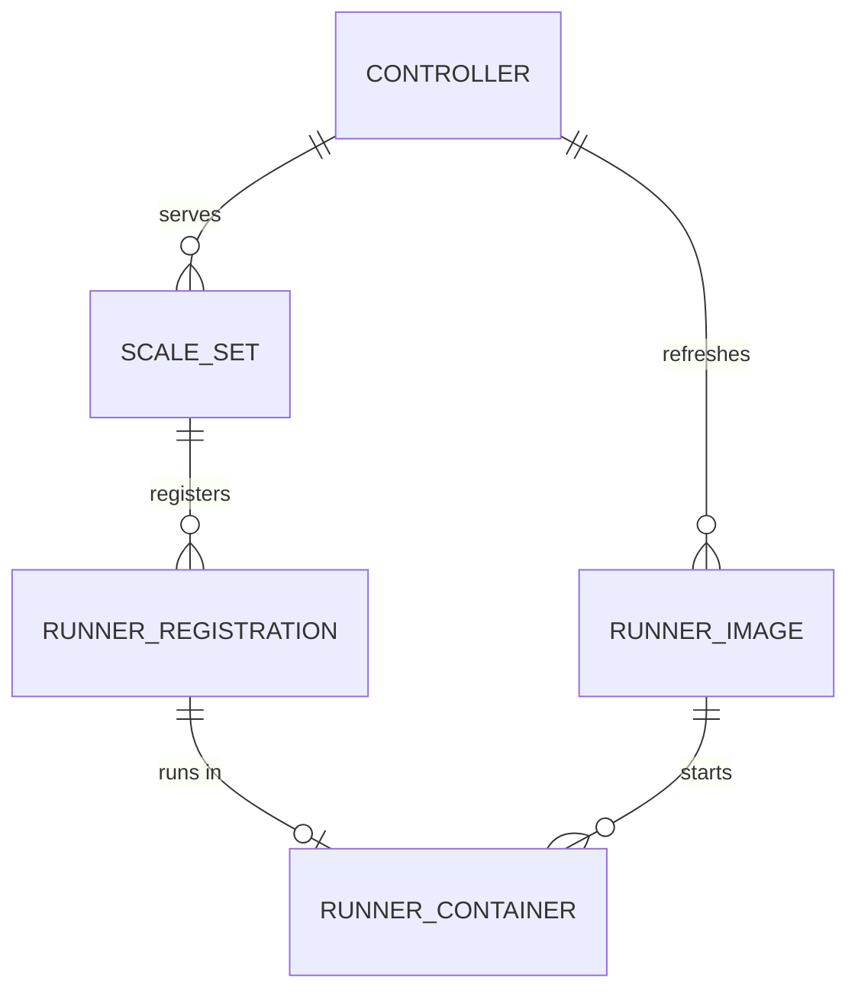

# Entity Model

The entities below are the contents of one Controller's State Store (C-007). Config values, Jobs,
start requests, and Slots are not stored: the Config is read from the environment at every start,
Jobs belong to GitHub, and start requests and Slots exist only while the Controller runs (UC-004
drops waiting start requests on shutdown). A record is deleted once the object it describes is
gone; the State Store keeps no history.

## Entity Relationship Diagram

### CONTROLLER

The Controller that owns this State Store, identified by its Instance ID.

| Attribute   | Description                                                   | Data Type | Length/Precision | Validation Rules      |
|-------------|---------------------------------------------------------------|-----------|------------------|-----------------------|
| id          | Unique identifier                                             | Long      | 19               | Primary Key, Sequence |
| instance_id | Instance ID from the Config; also part of the Instance label  | String    | 50               | Not Null, Unique      |
| created_at  | Time the State Store was first used by this Controller        | DateTime  | -                | Not Null              |

#### Constraints

- The State Store holds exactly one CONTROLLER row.
- instance_id must equal the Instance ID in the Config; a State Store holding another Instance ID belongs to another Controller.

### SCALE_SET

A Scale Set the Controller created or took over on one repository (FR-001, FR-036).

| Attribute           | Description                                                     | Data Type | Length/Precision | Validation Rules                      |
|---------------------|-----------------------------------------------------------------|-----------|------------------|---------------------------------------|
| id                  | Unique identifier                                               | Long      | 19               | Primary Key, Sequence                 |
| controller_id       | Controller that serves the Scale Set                            | Long      | 19               | Not Null, Foreign Key (CONTROLLER.id) |
| github_scale_set_id | ID GitHub assigned to the Scale Set                             | Long      | 19               | Not Null                              |
| repository          | Repository the Scale Set is registered on, as `owner/name`      | String    | 140              | Not Null                              |
| name                | Scale Set name that workflows target with `runs-on`             | String    | 100              | Not Null                              |
| origin              | Whether the Controller created the Scale Set or took it over    | String    | 20               | Not Null, Values: Created, TakenOver  |
| created_at          | Time the Scale Set was recorded in the State Store              | DateTime  | -                | Not Null                              |

#### Constraints

- The combination of controller_id and repository is unique: a Controller serves one Scale Set per repository.
- The combination of repository and github_scale_set_id is unique: GitHub numbers Scale Sets per repository, so the same ID recurs across repositories.
- A Scale Set whose repository or name is no longer in the Config is deleted on GitHub and then its row is removed (UC-003); the row stays while the deletion is retried.

### RUNNER_REGISTRATION

The ephemeral runner GitHub knows about for one Runner Container, created with a JIT Config and kept until GitHub confirms its deletion (FR-029).

| Attribute        | Description                                               | Data Type | Length/Precision | Validation Rules                     |
|------------------|-----------------------------------------------------------|-----------|------------------|--------------------------------------|
| id               | Unique identifier                                         | Long      | 19               | Primary Key, Sequence                |
| scale_set_id     | Scale Set the runner is registered in                     | Long      | 19               | Not Null, Foreign Key (SCALE_SET.id) |
| github_runner_id | ID GitHub assigned to the runner                          | Long      | 19               | Not Null                             |
| runner_name      | Runner name sent with the JIT Config request              | String    | 64               | Not Null, Unique                     |
| created_at       | Time the JIT Config was issued                            | DateTime  | -                | Not Null                             |

#### Constraints

- The combination of scale_set_id and github_runner_id is unique: GitHub numbers runners per repository.
- A row is removed only after GitHub has deleted the runner; a row whose Runner Container is gone stays so that the next start deletes it (UC-001 step 5, UC-004 A3).
- A SCALE_SET row is removed only after all its RUNNER_REGISTRATION rows are gone; a stale Scale Set is deleted on GitHub only once its recorded Runner Registrations are deleted (UC-001 BR-010).

### RUNNER_IMAGE

One version of a Runner Image on the Host: the current build of the default image or the current pull of a per-repository image, or a version a refresh has superseded (FR-030, FR-037).

| Attribute          | Description                                                         | Data Type | Length/Precision | Validation Rules                      |
|--------------------|---------------------------------------------------------------------|-----------|------------------|---------------------------------------|
| id                 | Unique identifier                                                   | Long      | 19               | Primary Key, Sequence                 |
| controller_id      | Controller that builds or pulls the image                           | Long      | 19               | Not Null, Foreign Key (CONTROLLER.id) |
| reference          | Image reference, the default image's tag or the per-repository image from the Config | String | 255 | Not Null                       |
| kind               | Whether the image is the built default or a pulled per-repository image | String | 20             | Not Null, Values: Default, Repository |
| digest             | Docker image ID of this version, `sha256:` plus 64 hex digits       | String    | 71               | Not Null                              |
| status             | Whether new Runner Containers start from this version               | String    | 20               | Not Null, Values: Current, Superseded |
| refreshed_at       | Time of the last successful build or pull that produced or confirmed this version | DateTime | - | Not Null                           |
| last_failed_at     | Time of the last failed refresh since refreshed_at                  | DateTime  | -                | Optional                              |

#### Constraints

- At most one row per combination of controller_id and reference has status Current.
- The combination of reference and digest is unique.
- At most one Current row has kind Default.
- A pull that returns the same digest updates refreshed_at of the Current row instead of adding a row.
- A Current row is overdue when refreshed_at lies more than 49 days back (UC-006 BR-003).
- The next refresh of a reference is due one refresh interval after refreshed_at, or one day after last_failed_at when that is later than refreshed_at.
- last_failed_at is cleared when a refresh succeeds.
- A Superseded row is removed together with its image once no RUNNER_CONTAINER row references it (UC-006 BR-006).

### RUNNER_CONTAINER

A single-use container started from a Runner Image with the JIT Config of one Runner Registration (FR-006).

| Attribute              | Description                                                        | Data Type | Length/Precision | Validation Rules                                   |
|------------------------|--------------------------------------------------------------------|-----------|------------------|----------------------------------------------------|
| id                     | Unique identifier                                                  | Long      | 19               | Primary Key, Sequence                              |
| runner_registration_id | Runner Registration whose JIT Config the container runs            | Long      | 19               | Not Null, Foreign Key (RUNNER_REGISTRATION.id)     |
| runner_image_id        | Runner Image version the container was started from                | Long      | 19               | Not Null, Foreign Key (RUNNER_IMAGE.id)            |
| docker_container_id    | ID the Docker Engine assigned to the container                     | String    | 64               | Not Null, Unique                                   |
| status                 | Lifecycle state of the container                                   | String    | 20               | Not Null, Values: Idle, Busy, Removing             |
| job_id                 | Job ID from the JobStarted message                                 | String    | 50               | Optional                                           |
| started_at             | Time the container was started                                     | DateTime  | -                | Not Null                                           |
| ready_at               | Time the container wrote the Ready marker                          | DateTime  | -                | Optional                                           |
| job_started_at         | Time the JobStarted message arrived                                | DateTime  | -                | Optional                                           |

#### Constraints

- runner_registration_id is unique: a Runner Registration runs in at most one Runner Container.
- ready_at, when set, is not before started_at.
- job_started_at, when set, is not before started_at.
- job_id and job_started_at are both set or both empty.
- status Idle requires job_id to be empty: no JobStarted message has named the container's Job yet, and GitHub has not refused the deletion of its Runner Registration.
- status Busy is set when the JobStarted message arrives, or when GitHub refuses the deletion of the Runner Registration because the runner holds a Job (UC-004 A6, UC-007 A6, UC-008 A3); job_id stays empty until the JobStarted message arrives.
- status Removing is set when the Controller starts removing the container; the row stays while the removal is retried, and the container keeps its Slot until then.
- The row is removed once the Docker Engine has removed the container; its RUNNER_REGISTRATION row stays until GitHub has deleted the runner.
